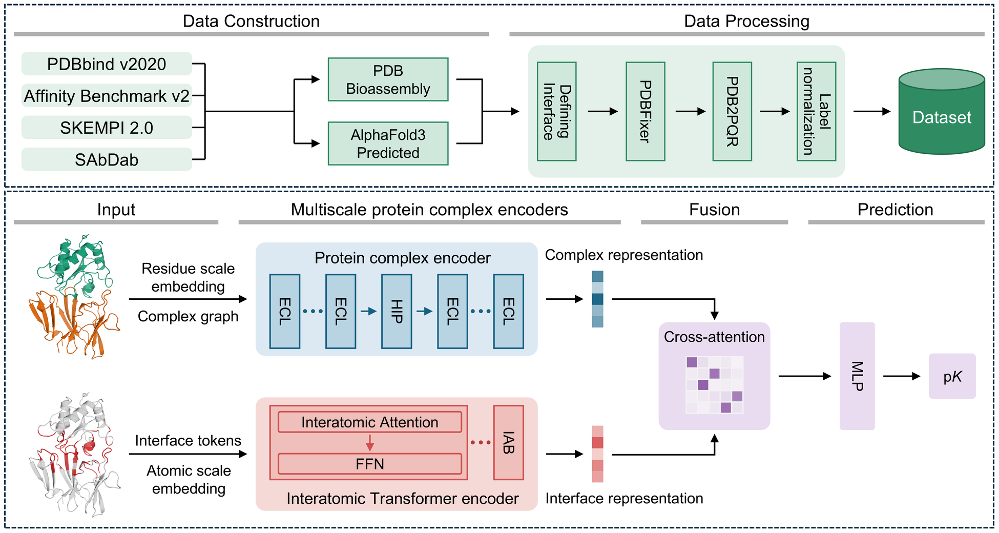

# HIPIT-Affinity: Multiscale Learning for Protein–Protein Binding Affinity Prediction

## Overview

<p align="center">
  
</p>

Protein–protein binding affinity quantifies the strength of interactions between binding partners and is essential for understanding complex formation and supporting drug discovery. Because experimental measurements are resource-intensive, deep learning models that predict binding affinity from complex structures offer an alternative for large-scale applications. Here, we propose HIPIT-Affinity, a multiscale framework that predicts binding affinity by representing entire protein complexes at the residue scale and binding interfaces at the atomic scale. Prior to training, missing atoms in the complex structures are reconstructed and hydrogen atoms are added, after which interfaces are defined using buried surface area (BSA). Each complex is represented as a complex graph, and an E(n)-equivariant graph neural network (EGNN) incorporates geometric information to learn its global structure. In addition, Hierarchical Interface-aware Pooling (HIP), applied within the EGNN updates, preserves interface residues while contracting non-interface regions to facilitate learning of long-range structural relationships across the complex. In parallel, the interface is represented as hydrogen-inclusive atomic tokens, and an Interatomic Transformer (IT) learns local interatomic interactions from atom-pair features and interatomic distances. Finally, cross-attention fuses the two representations to predict binding affinity. HIPIT-Affinity achieved Pearson correlation coefficients of 0.695 on the Combined set of the two benchmark sets and 0.476 on an antibody–antigen set curated in this work from SAbDab, the highest among the evaluated methods on this set. In nanobody–antigen case studies, attention was concentrated on CDR-H3 in all complexes, and the model selectively emphasized regions involved in antigen recognition without complementarity-determining region (CDR) annotations, providing interpretability for its predictions.

## Installation

The code was tested on Linux (x86_64) with an NVIDIA GPU (CUDA 12.6).

```bash
git clone https://github.com/Boseong-K/HIPIT_Affinity.git
cd HIPIT_Affinity
conda env create -f environment.yml
conda activate HIPIT-Affinity
```

The environment includes PyTorch 2.6.0, PyTorch Geometric 2.7.0, and all tools used for structure processing: PDBFixer/OpenMM, PDB2PQR, FreeSASA, Open Babel, APBS, and ESM (EvolutionaryScale). The ESM C 600M weights (`EvolutionaryScale/esmc-600m-2024-12`) are downloaded from Hugging Face on first use.

## Data Preparation

- **PDBbind v2020**: [Website](http://www.pdbbind.org.cn/download.php) | [Liu et al., *Bioinformatics* 2015](https://doi.org/10.1093/bioinformatics/btu626)
- **SKEMPI 2.0**: [Website](https://life.bio.sunysb.edu/skempi/) | [Jankauskaitė et al., *Bioinformatics* 2019](https://doi.org/10.1093/bioinformatics/bty635)
- **SAbDab**: [Website](https://opig.stats.ox.ac.uk/webapps/sabdab-sabpred/sabdab) | [Dunbar et al., *Nucleic Acids Res.* 2014](https://doi.org/10.1093/nar/gkt1043)

Download the structures and binding affinities from these databases, and prepare a CSV file, a `PDB/` folder, and a `FASTA/` folder for each dataset under `Datasets/`.

```
Datasets/<Dataset>/
├── <Dataset>.csv   # labels
├── PDB/            # <PDB>.pdb
└── FASTA/          # <PDB>.fasta, header ">1NBY | chain A"
```

| Column | Description |
|---|---|
| `PDB` | Complex identifier matching the file names in `PDB/` and `FASTA/` |
| `pKD` | Binding affinity, −log<sub>10</sub>(*K*<sub>D</sub>), used as the label |
| `BindingChainPair` | Chains of the two binding partners separated by ` : `, e.g., `A : D` or `AB : C` |

The training set must be named `Train`, and its training/validation split is given in `Datasets/split.txt`. Example files are provided in `Datasets/`.

## Data Processing & Representation

The scripts in `Protein Representation/` build the residue-scale and atomic-scale representations. Run them in the following order.

| Step | Script | Description |
|---|---|---|
| 1 | `PDBFIXER.py` | Reconstructs missing atoms |
| 2 | `PDB2PQR.py` | Adds hydrogen atoms and assigns charges and radii (PARSE) |
| 3 | `Interface.py` | Selects complexes with a BSA of 600–2,000 Ų and defines atoms whose SASA decreases upon complex formation as the interface |
| 4 | `Residue_graph.py` | Builds residue-scale complex graphs with ESM C embeddings |
| 5 | `HIP_Cluster.py` | Computes cluster assignments for HIP |
| 6 | `Atom_token.py` | Builds atomic-scale interface tokens |

Before running, set the following variables at the top of the scripts:

- `Residue_graph.py`: `DATASET_NAMES = ("Train", "Test1")`
- `Atom_token.py`: `DATASET_ROOT = "../Datasets"`, `OUTPUT_ROOT = "../Representation/Atom_Token"`, and `DATASET_NAMES` as above

**Run**

```bash
cd "Protein Representation"
SETS="Train Test1"

python PDBFIXER.py  --dataset-root ../Datasets --datasets $SETS
python PDB2PQR.py   --dataset-root ../Datasets --datasets $SETS
python Interface.py --dataset-root ../Datasets --datasets $SETS
python Residue_graph.py --dataset-root ../Datasets --output-root ../Representation/Residue_Graph \
                        --datasets $SETS --esmc-device cuda:0
python HIP_Cluster.py --input-root ../Representation/Residue_Graph \
                      --output-root ../Representation/Interface_Cluster
python Atom_token.py
```

**Output**

```
Datasets/<Dataset>/
├── <Dataset>.csv                    # labels
├── PDB/                             # <PDB>.pdb
├── FASTA/                           # <PDB>.fasta, header ">1NBY | chain A"
├── PDBFIXER/                        # Step 1: <PDB>.pdb with missing atoms reconstructed
├── PQR/                             # Step 2: <PDB>.pqr with hydrogens, charges, and radii
└── Interface/                       # Step 3: <PDB>.pqr of interface atoms
Representation/
├── Residue_Graph/<Dataset>/         # Step 4: <PDB>.pt residue-scale complex graphs
├── Interface_Cluster/<Dataset>/     # Step 5: <PDB>.pt HIP cluster assignments
└── Atom_Token/<Dataset>/            # Step 6: <PDB>.pt atomic-scale interface tokens
```

Complexes outside the BSA range are excluded at Step 3 and listed in `Interface/not_saved_pdb_list.txt`.

Each residue node carries a 1,152-dimensional ESM C embedding, and each atomic token carries 40 features (element, residue type, atom type, circular variance, cross contacts, SASA, ΔSASA, electrostatic potential from APBS, partial charge, and atomic radius).

## Training

```bash
cd Model
python HIPIT_Affinity.py --dataset-root ../Datasets \
                         --representation-root ../Representation \
                         --output-root ../Output \
                         --model-name HIPIT-Affinity
```

- By default (`USE_CROSS_VALIDATION = True` in `TrainParams`), five-fold cross-validation is performed on the training set only, and the test sets are not used.
- Set it to `False` to train on the split defined in `Datasets/split.txt` and evaluate the trained model on every test set found in `Datasets/`; use `--datasets Test1` to select specific sets.

## Inference

Inference requires a trained checkpoint, such as `HIPIT-Affinity.pt` saved by the training step, and the representations of the input dataset built in Data Processing & Representation.

```bash
cd Model
python Inference.py --checkpoint ../Output/HIPIT-Affinity.pt \
                    --input Test1 \
                    --labels ../Datasets/Test1/Test1.csv \
                    --representation-root ../Representation \
                    --device cuda:0 \
                    --output Test1_predictions.csv
```

`--input` is the name of a folder under `Representation/Residue_Graph/` and `Representation/Atom_Token/`. The script prints RMSE, MAE, Pearson *R*, and *R*<sup>2</sup> and writes the predictions as `PDB,Actual,Predicted`.

## Citation

## License

This project is licensed under the MIT License. See [LICENSE](LICENSE) for details.

## Contact

- Boseong Kim (qhtjd0910@kangwon.ac.kr), Graduate School of Data Science, Kangwon National University
- Chihyun Park (chihyun@kangwon.ac.kr), Department of Computer Science and Engineering, Kangwon National University
